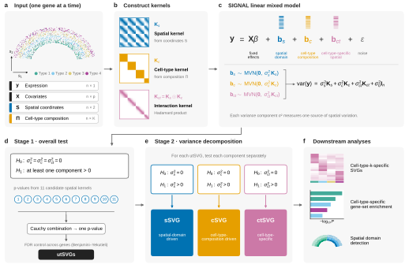

# SIGNAL: Spatial varIable Gene detectioN And cLassification


SIGNAL is a statistical method to detect spatially variable genes in single-cell resolution spatial transcriptomics and classify them by the source of their spatial variation. For each gene, SIGNAL fits a multi-kernel variance component model with a cell-type kernel, a spatial kernel and their interaction. An overall test detects any effect. Separate tests then classify each detected gene as having a **cell-type** effect (expression differs between cell types), a **spatial** effect (expression varies over space for all cell types) and/or a **cell-type-specific spatial** effect (ctSVG). A second-stage test finds the cell types that carry each ctSVG pattern: a spatial test within each cell type's cells for single-cell data, and a test of one cell type's interaction kernel for spot-level data. Results are combined across a panel of spatial kernels with the Cauchy combination test.

**Reference**: Hou, T. *et al.* SIGNAL: Spatial varIable Gene detectioN And cLassification. (in preparation)

## Installation
Please run the following codes in R to install SIGNAL package from GitHub.
```
if (!require("devtools", quietly = TRUE)){
  install.packages("devtools")
}
devtools::install_github("TingtHou/SIGNAL", build_vignettes = TRUE)
```

SIGNAL depends only on `CompQuadForm`, `ggplot2`, `pbmcapply`, `RhpcBLASctl` and packages that ship with R (`mgcv`, `methods`, `parallel`, `stats`, `utils`). It does not need compilation.

## Detect and classify spatially variable genes with SIGNAL
The best vignette for getting started with SIGNAL is the [Tutorial](https://tingthou.github.io/SIGNAL/tutorial.html). After installation, you can also open it in R with `vignette("SIGNAL")`.

```
library(SIGNAL)
data(SIGNAL_example)

obj <- createSIGNALobject(counts   = SIGNAL_example$counts,    # genes x cells
                          location = SIGNAL_example$location,  # cells x 2
                          celltype = SIGNAL_example$celltype)  # one label per cell
obj <- SIGNAL_preprocess(obj, seed = 1)  # filter genes, rank-based normal transform
obj <- SIGNAL_kernel(obj)                 # cell-type kernel + 11 spatial kernels

obj <- SIGNAL_overall(obj)                # step 1: overall test, all genes
detected <- rownames(obj@result)[p.adjust(obj@result$p_overall, "BH") < 0.05]
obj <- SIGNAL_component(obj, genes = detected)   # step 2: cell-type, spatial, ctSVG tests

head(obj@result)          # genes x p-values: p_overall, p_celltype, p_spatial, p_ctSVG

ctsvg <- detected[obj@result[detected, "p_ctSVG"] < 0.05]
obj <- SIGNAL_celltype(obj, genes = ctsvg)  # which cell types carry each ctSVG
obj@celltype_result       # genes x cell types p-values
SIGNAL_plotGene(obj, "gene61", by_celltype = TRUE)
```
