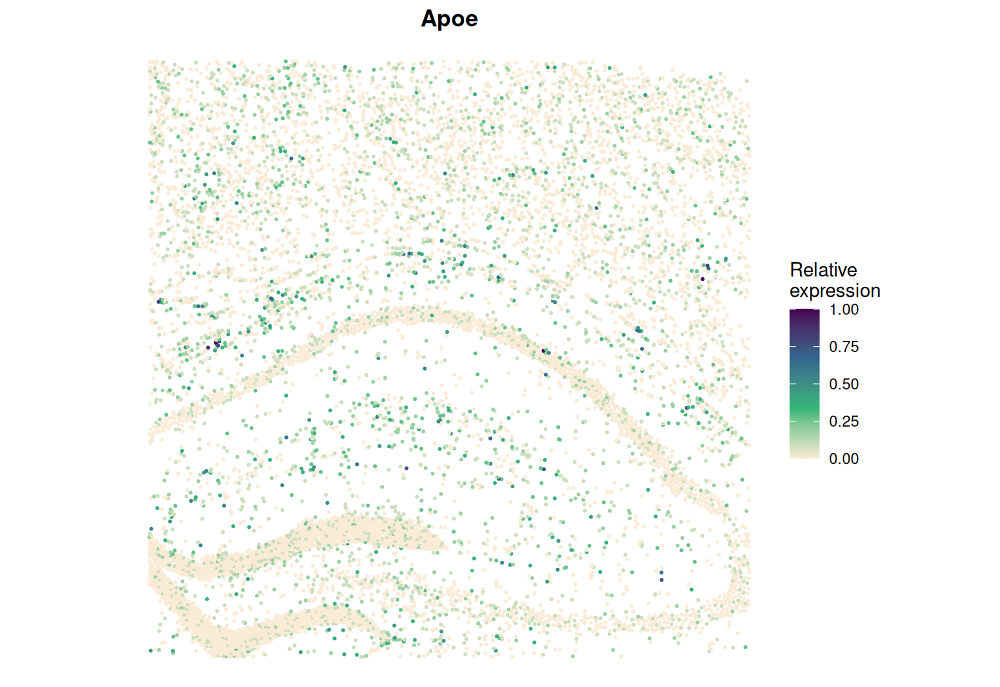

```{r setup, include = FALSE}
knitr::opts_chunk$set(eval = FALSE)
```

This page analyses spot-level data, where each location has **cell-type
proportions** instead of a single label: STARmap PLUS data of the hippocampus
of a 13-month-old Alzheimer's disease mouse model (Zeng *et al.*, 2023). With
more than 6,000 cells it also shows SIGNAL's settings for large data.

## Data

The processed data used on this page, `starmap_plus_data_use.RData` (counts,
locations and cell-type proportions), can be downloaded from the
[SIGNAL real data folder](https://drive.google.com/drive/folders/1-j6l-KBT9dR_p2RB2RVb_5q9Ig2GdRn3)
on Google Drive. The raw data are sample
`spatial_13months-disease-replicate_1` of study SCP1375 on the Broad Single
Cell Portal: 2,766 genes on 9,244 cells. Each segmented cell is treated as a
near-cellular spot, and its cell-type composition is estimated by
reference-based deconvolution (CARD with the DropViz mouse hippocampus
reference).

```{r}
library(SIGNAL)
library(Matrix)
load("starmap_plus_data_use.RData")
prop <- as.matrix(data_use$celltype_proportion)
prop <- prop[, colSums(prop) > 100]       # cell types with enough cells
```

## Step 1: create a SIGNAL object

```{r}
obj <- createSIGNALobject(counts   = data_use$count_use,
                          location = data_use$location_use,
                          celltype = prop)
```

## Step 2: filter and transform

```{r}
obj <- SIGNAL_preprocess(obj, min_cells = 0)
```

## Step 3: build the kernels

Two of SIGNAL's automatic choices apply:

* **Cell-type kernel:** the cell-type input is a matrix of proportions, so
  SIGNAL uses a Gaussian kernel on the Euclidean distance between proportion
  vectors (`celltype_distance = "auto"`).
* **Spatial kernel:** with more than 6,000 cells, SIGNAL builds one Gaussian
  kernel instead of 11 (`approximation = "auto"`), with its bandwidth chosen
  from the expression data by Silverman's rule.

```{r}
obj <- SIGNAL_kernel(obj)
obj@params$kernel[c("celltype_distance", "approximation", "bandwidth")]
```

## Step 4: the overall test

Each n × n matrix takes 0.68 GB at 9,244 cells; the main process holds about
20 of them and each parallel worker about 7 more. Choose `ncores` so that the
memory fits:

| Workers (`ncores`) | Memory needed |
|---|---|
| 1 | about 17 GB |
| 8 | about 50 GB |
| 12 | about 70 GB |
| 20 | about 110 GB |

```{r}
obj <- SIGNAL_overall(obj, ncores = 12)
detected <- rownames(obj@result)[p.adjust(obj@result$p_overall, "BH") < 0.05]
```

## Step 5: the component tests

The cell-type, spatial and ctSVG tests run only for the detected genes, with
the same memory per worker.

```{r}
obj <- SIGNAL_component(obj, genes = detected, ncores = 12)
write.csv(obj@result, "hippocampus_signal_pvalues.csv")
```

## Step 6: find the cell types behind each ctSVG

```{r}
ctsvg <- detected[obj@result[detected, "p_ctSVG"] < 0.05]
obj   <- SIGNAL_celltype(obj, genes = ctsvg, ncores = 12)
obj@celltype_result
```

## Step 7: visualise a gene

```{r}
SIGNAL_plotGene(obj, "Apoe", point_size = 0.4)
```

```{r, eval = TRUE, echo = FALSE, out.width = "100%"}

```
