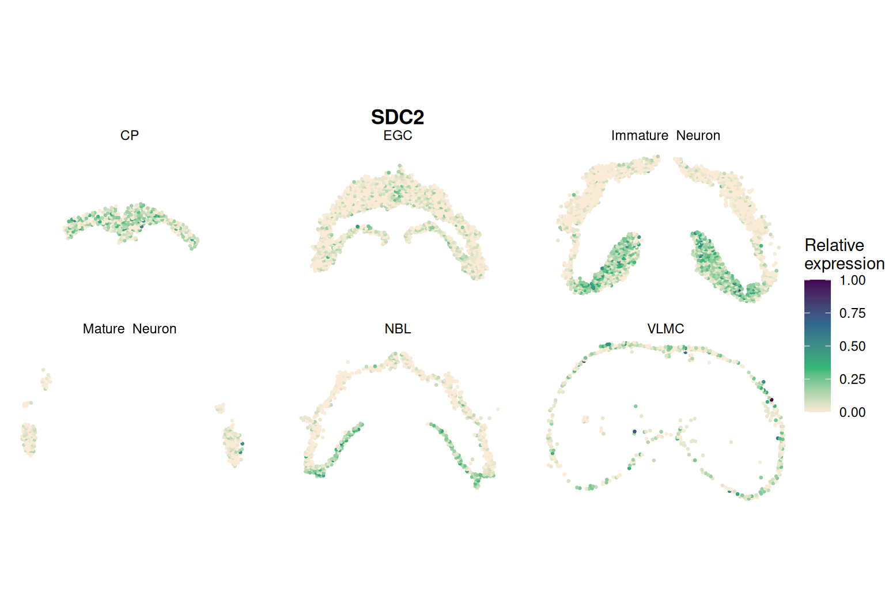

```{r setup, include = FALSE}
knitr::opts_chunk$set(eval = FALSE)
```

This page analyses single-cell resolution Stereo-seq data of the axolotl brain
at developmental stage 57 (Wei *et al.*, 2022), with cell-type labels and the
panel of 11 spatial kernels.

## Data

The processed data used on this page, `artista_data.RData`, can be downloaded
from the [SIGNAL real data folder](https://drive.google.com/drive/folders/1-j6l-KBT9dR_p2RB2RVb_5q9Ig2GdRn3)
on Google Drive. The raw data are in the ARTISTA database
(<https://db.cngb.org/stomics/artista/download/>); we removed mitochondrial
genes, kept genes with non-zero expression in at least 20 locations and
locations with non-zero expression for at least 20 genes, leaving 16,586 genes
on 4,410 locations in six cell types.

```{r}
library(SIGNAL)
library(Matrix)
load("artista_data.RData")    # data_use$count_use, $location_coord, $cluster
```

## Step 1: create a SIGNAL object

```{r}
obj <- createSIGNALobject(counts   = data_use$count_use,
                          location = data_use$location_coord,
                          celltype = data_use$cluster)
```

## Step 2: filter and transform

The genes were already filtered, so `min_cells = 0` keeps all of them.

```{r}
obj <- SIGNAL_preprocess(obj, min_cells = 0)
```

## Step 3: build the kernels

Cell-type labels give the Hamming cell-type kernel. With 4,410 cells (fewer
than 6,000), SIGNAL builds the panel of 11 spatial kernels.

```{r}
obj <- SIGNAL_kernel(obj)
```

## Step 4: the overall test

```{r}
obj <- SIGNAL_overall(obj, ncores = 20)
detected <- rownames(obj@result)[p.adjust(obj@result$p_overall, "BH") < 0.05]
```

## Step 5: the component tests

The cell-type, spatial and ctSVG tests run only for the detected genes.

```{r}
obj <- SIGNAL_component(obj, genes = detected, ncores = 20)
write.csv(obj@result, "artista_signal_pvalues.csv")
```

## Step 6: visualise a gene

```{r}
SIGNAL_plotGene(obj, "SDC2", by_celltype = TRUE, point_size = 0.5)
```

```{r, eval = TRUE, echo = FALSE, out.width = "100%"}

```

## Running on a cluster in batches of genes

With 16,586 genes and 11 kernels, the analysis is best split into batches of
genes, one per task of a Slurm job array, and the result tables combined
afterwards:

```{r}
part  <- as.integer(Sys.getenv("SLURM_ARRAY_TASK_ID"))
genes <- rownames(data_use$count_use)
batch <- genes[parallel::splitIndices(length(genes), 100)[[part]]]
obj <- SIGNAL(data_use$count_use[batch, ], data_use$location_coord, data_use$cluster,
              min_cells = 0)                     # ncores = the Slurm allocation
saveRDS(obj@result, sprintf("artista_part_%03d.rds", part))
```

```{bash}
sbatch --array=1-100 --cpus-per-task=20 --mem-per-cpu=4G --time=24:00:00 run_artista.sh
```

With 4,410 cells, each spatial kernel takes about 17 minutes for 160 genes on
20 cores, so a batch of 160 genes needs about 3 hours and 30 GB of memory.
