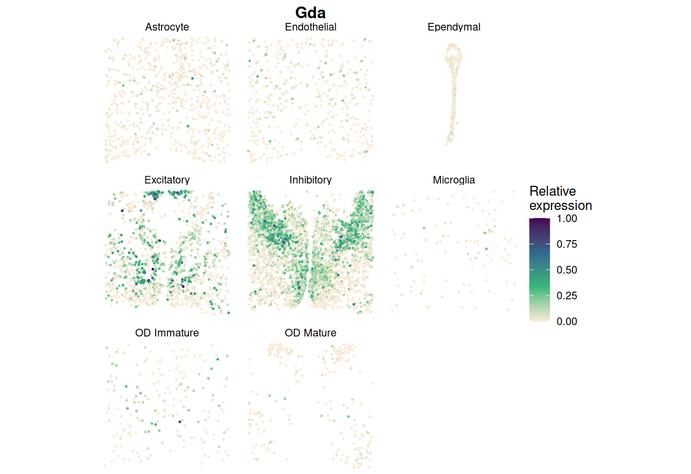

```{r setup, include = FALSE}
knitr::opts_chunk$set(eval = FALSE)
```

This page analyses single-cell MERFISH data of the preoptic area of the mouse
hypothalamus (Moffitt *et al.*, 2018), with cell-type labels and a single
Gaussian spatial kernel.

## Data

The processed data used on this page, `Mouse_hypothalamic_preoptic.Rdata`,
can be downloaded from the
[SIGNAL real data folder](https://drive.google.com/drive/folders/1-j6l-KBT9dR_p2RB2RVb_5q9Ig2GdRn3)
on Google Drive. The data come from the BASS analysis page
(<https://zhengli09.github.io/BASS-Analysis/MERFISH.html>): the tissue section
at Bregma −0.09 mm from animal 1, with 155 genes on 5,557 cells. The 37
pericytes are too few for per-cell-type testing and are removed, leaving 5,520
cells in eight cell types.

```{r}
library(SIGNAL)
library(Matrix)
load("Mouse_hypothalamic_preoptic.Rdata")   # data_use$count_use, $location_coord, $cluster
keep     <- data_use$cluster != "Pericytes"
counts   <- data_use$count_use[, keep]
location <- data_use$location_coord[keep, ]
celltype <- droplevels(factor(data_use$cluster[keep]))
```

## Step 1: create a SIGNAL object

```{r}
obj <- createSIGNALobject(counts, location, celltype)
```

## Step 2: filter and transform

```{r}
obj <- SIGNAL_preprocess(obj, min_cells = 0)
```

## Step 3: build the kernels

Cell-type labels give the Hamming cell-type kernel. As in CELINA's
approximation mode, we use one Gaussian spatial kernel (`approximation = TRUE`);
its bandwidth is chosen from the expression data by Silverman's rule.

```{r}
obj <- SIGNAL_kernel(obj, approximation = TRUE)
obj@params$kernel$bandwidth
```

To use the panel of 11 spatial kernels instead, leave out
`approximation = TRUE` (5,520 cells is below the 6,000-cell threshold).

## Step 4: the overall test

```{r}
obj <- SIGNAL_overall(obj, ncores = 8)
detected <- rownames(obj@result)[p.adjust(obj@result$p_overall, "BH") < 0.05]
```

## Step 5: the component tests

The cell-type, spatial and ctSVG tests run only for the detected genes.

```{r}
obj <- SIGNAL_component(obj, genes = detected, ncores = 8)
write.csv(obj@result, "mouse_signal_pvalues.csv")
```

## Step 6: visualise a gene

```{r}
SIGNAL_plotGene(obj, "Gda", by_celltype = TRUE, point_size = 0.4)
```

```{r, eval = TRUE, echo = FALSE, out.width = "100%"}

```

*Gda* is concentrated in a V-shaped region in inhibitory neurons and in the
upper central region in excitatory neurons.
